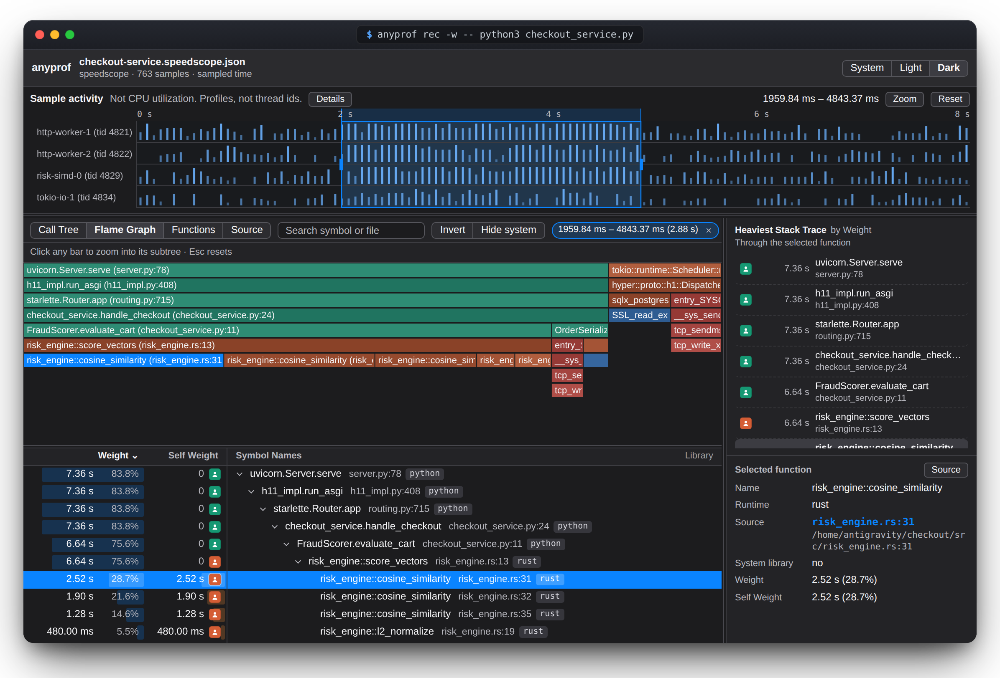
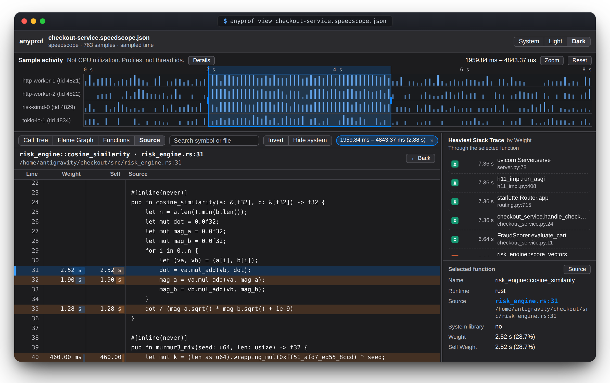
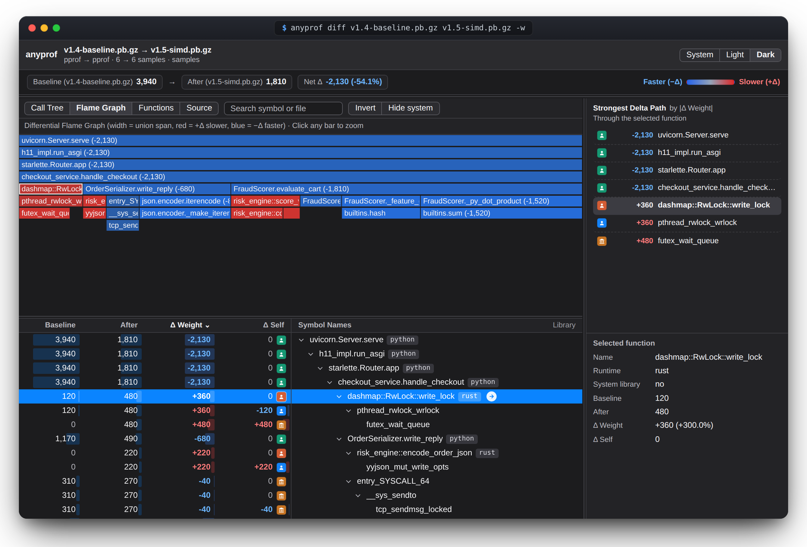

<div align="center">

# anyprof

**Capture CPU profiles from any running process — no code changes, agents, or restarts required.**

[](https://github.com/anyprofiler/anyprof/actions/workflows/ci.yml)
[](https://github.com/anyprofiler/anyprof/releases/latest)
[](Cargo.toml)
[](LICENSE)

[Install](#install) · [Quick Start](#quick-start) · [Built-in Viewer & Diff](#built-in-viewer--differential-flame-graph) · [Runtimes & Platforms](#runtime--platform-support) · [CLI Reference](#cli-reference) · [Permissions](#permissions--platform-notes) · [Internals](docs/internals.md)

</div>

<p align="center">
  <picture>
    <source media="(prefers-color-scheme: dark)" srcset="docs/assets/viewer-flame-dark.png">
    <source media="(prefers-color-scheme: light)" srcset="docs/assets/viewer-flame-light.png">
    
  </picture>
</p>

`anyprof` attaches to a live process by PID or name, spawns a command from startup, or connects to a browser tab over CDP — recording on-CPU stacks behind a unified `Backend` model and writing standard profile formats or opening them directly in a built-in, zero-dependency offline viewer.

- **7 runtimes, one CLI**: Node.js, Browser tabs (Chrome / Chromium / Edge), C/C++, Rust, Go (1.18–1.26+), Python (CPython 3.11–3.14), and Java (HotSpot JDK 17 / 21 / 25).
- **Cross-language mixed stacks**: Stitches C/C++ and `PyO3` Rust extensions onto `[python]` stacks, JNI / Panama FFM native frames onto `[java]` stacks, and `-k` `[kernel]` callchains onto user frames.
- **Zero-`sudo` daily workflow**: Native sampling without root on Windows `x64`, Linux (`x86_64` & `aarch64`), and macOS (via `anyprof setup` debugger entitlements or Apple Instruments `xctrace`).
- **Apple Instruments-grade offline viewer**: `anyprof view` / `anyprof rec -w` serves an interactive Call Tree, Flame Graph, Functions table, `[t0, t1]` timeline brush, and `file:line` Source view on `127.0.0.1` — uploading nothing anywhere.
- **Differential Flame Graphs**: `anyprof diff <BEFORE> <AFTER> -w` pinpoints latency regressions (`+Δ` red) and optimizations (`-Δ` blue) across any mix of `pprof`, Speedscope, `.cpuprofile`, and `.collapsed` files.

---

## Install

Prebuilt binaries are published on [GitHub Releases](https://github.com/anyprofiler/anyprof/releases) and installed into `~/.cargo/bin`:

**macOS & Linux:**

```bash
curl --proto '=https' --tlsv1.2 -LsSf https://github.com/anyprofiler/anyprof/releases/latest/download/anyprof-cli-installer.sh | sh
```

**Windows (PowerShell):**

```powershell
powershell -ExecutionPolicy Bypass -c "irm https://github.com/anyprofiler/anyprof/releases/latest/download/anyprof-cli-installer.ps1 | iex"
```

**Upgrade in place** (verifies SHA-256 checksums from `github.com/anyprofiler/anyprof`):

```bash
anyprof update
```

**Build from source** (requires Rust 1.88+; omits the `self-update` HTTP/TLS stack by default):

```bash
cargo install --git https://github.com/anyprofiler/anyprof anyprof-cli
```

## Quick Start

```bash
# Attach by PID or unique process name, or spawn a command from startup
anyprof rec -p 1234 -d 10s -w                    # sample PID 1234 and open built-in viewer
anyprof rec -n checkout-api -d 10s -w            # match running process by name/cmdline
anyprof rec -w -- python3 checkout_service.py    # spawn child and profile until exit / Ctrl+C

# macOS without sudo (one-time debugger entitlement sign, or Apple Instruments xctrace)
anyprof setup --yes                              # sign binary with com.apple.security.cs.debugger
anyprof rec -p 1234 -d 10s                       # samples Python, Java, Go, Rust, & C/C++ without sudo
anyprof rec -b xctrace -p 1234 -d 10s            # explicit 1,000 Hz Instruments Time Profiler

# Browser tab (start Chrome/Edge with --remote-debugging-port=9222)
anyprof rec -B -t example.com -d 10s -o page.cpuprofile

# Inspect any .cpuprofile, .pb.gz, .speedscope.json, or .collapsed file offline
anyprof view profile.pb.gz
anyprof view cpu.speedscope.json --no-open --port 8123

# Compare before/after captures in a Differential Flame Graph or Markdown report
anyprof diff v1.4-baseline.pb.gz v1.5-simd.pb.gz -w
anyprof diff baseline.cpuprofile current.cpuprofile -o diff.md

# Convert between collapsed, speedscope, pprof, and cpuprofile
anyprof conv -i profile.cpuprofile -o cpu.collapsed -t collapsed
anyprof conv -i cpu.collapsed -o cpu.pb.gz -t pprof
```

---

## Built-in Viewer & Differential Flame Graph

### Line-by-Line Source Attribution (`Source` Tab)

`anyprof` resolves source files and line numbers directly during capture — reading DWARF `.debug_line` (v2–v5) on Linux ELF and macOS Mach-O / `.dSYM`, PDB C13 / `SymGetLineFromAddrW64` on Windows, Go `pclntab`, CPython `co_linetable`, V8 script URLs, and HotSpot `ConstMethod` line tables. Clicking any frame opens the local `Source` view with per-line `Weight` and `Self` heat bars:

<p align="center">
  <picture>
    <source media="(prefers-color-scheme: dark)" srcset="docs/assets/viewer-source-dark.png">
    <source media="(prefers-color-scheme: light)" srcset="docs/assets/viewer-source-light.png">
    
  </picture>
</p>

### Differential Flame Graph (`anyprof diff -w`)

Compare any two captures (`BEFORE` vs `AFTER`) to verify optimizations and catch unexpected lock or syscall regressions. Union-span bar widths keep 100%-eliminated code paths visible (`-Δ` blue) right alongside newly introduced hotspots (`+Δ` red):

<p align="center">
  <picture>
    <source media="(prefers-color-scheme: dark)" srcset="docs/assets/viewer-diff-dark.png">
    <source media="(prefers-color-scheme: light)" srcset="docs/assets/viewer-diff-light.png">
    
  </picture>
</p>

---

## Runtime & Platform Support

| Runtime | Backend | Default Rate & Format | macOS (`arm64` & Intel) | Windows `x64` | Linux (`x86_64` & `aarch64`) | Key Notes |
| --- | --- | --- | --- | --- | --- | --- |
| **Node.js** | `node` | 10,000 Hz · `.cpuprofile` | Supported | Supported | Supported | Activates V8 inspector (`SIGUSR1` / `_debugProcess`); closes temporary port on exit |
| **Browser** | `browser` | 10,000 Hz · `.cpuprofile` | Supported | Supported | Supported | Connects to `--remote-debugging-port` (`127.0.0.1:9222`); match tab by URL, title, or ID |
| **C / C++** | `native` | 99 Hz · `pprof` (`.pb.gz`) | Supported | Supported | Supported | Mach `task_for_pid` / Instruments `xctrace` (macOS), `StackWalk64` (Windows), `perf_event_open` (Linux) |
| **Rust** | `rust` | 99 Hz · `pprof` (`.pb.gz`) | Supported | Supported | Supported | Offline DWARF / Compact Unwind / PE `.pdata` + `rustc-demangle` (`[rust]` frames) |
| **Go** | `go` | 99 Hz · `pprof` (`.pb.gz`) | Supported | Supported | Supported | Go 1.18–1.26+ `pclntab` (`pcsp`) unwind; works on stripped (`-s -w`) binaries |
| **Python** | `python` | 99 Hz · `speedscope` | Supported | Supported | Supported | CPython 3.11–3.14 (GIL); stitches C/C++/`PyO3` Rust extensions onto `[python]` frame chains |
| **Java** | `java` | 99 Hz · `speedscope` | Supported | Supported | Supported | HotSpot JDK 17, 21, 25; stitches JNI/FFM native frames onto CodeCache & interpreter `[java]` stacks |
| **Instruments** | `xctrace` | 1,000 Hz · `pprof` (`.pb.gz`) | Supported | — | — | Explicit `-b xctrace` (or automatic non-root fallback) via Apple Instruments `Time Profiler` |

When `--backend` is omitted, auto-detection checks `node` → `rust` → `go` → `python` → `java` → `native` (`browser` requires `-B` / `--browser` or `-b browser`; `xctrace` is used via `-b xctrace` or automatic macOS non-root fallback). Non-native frames are prefixed with `[runtime]` (`[node]`, `[rust]`, `[go]`, `[python]`, `[java]`, `[kernel]`) so mixed stacks preserve frame origin. Other CPU architectures compile cleanly and return not-implemented on `start`.

---

## CLI Reference

### `anyprof record` (alias `rec`)

| Option | Description |
| --- | --- |
| `-p, --pid <PID>` | Target process ID (one of `-p`, `-n`, `-B`, or `-- <COMMAND>` is required). |
| `-n, --name <NAME>` | Match a unique running process by name or command-line substring (fails closed if ambiguous). |
| `-- <COMMAND> [ARGS...]` | Spawn a child command, profile it from startup until exit or `-d`, and propagate its exit code. |
| `-B, --browser` | Profile a browser tab over CDP (default endpoint `127.0.0.1:9222`). |
| `-t, --tab <QUERY>` | Select browser tab by target ID or URL/title substring (requires `--browser`). |
| `-i, --inspect <ENDPOINT>` | Inspector port, `host:port`, `http://`, or `ws://` URL. |
| `--keep-inspector` | Keep a Node.js inspector port open when `anyprof` activated it (pre-existing ports always stay open). |
| `-d, --duration <DURATION>` | Sampling duration (e.g. `10s`, `1m30s`). Omit to sample until `Ctrl+C` / `SIGTERM` (or child exit). |
| `-o, --output <PATH>` | Output file or directory. Defaults to `anyprof-<backend>-<pid>-YYYYMMDD-HHMMSS.<ext>`. |
| `-f, --format <FORMAT>` | `collapsed`, `pprof`, `speedscope`, or `cpuprofile` (inferred from `-o` extension or backend default). |
| `-F, --frequency <HZ>` | Sampling rate (`1`–`1000000` Hz). Mutually exclusive with `--interval`. |
| `--interval <DURATION>` | Sampling period (e.g. `100us`, `1ms`, `10ms`). Mutually exclusive with `-F`. |
| `-k, --kernel` | Include kernel stack frames (supported on Linux `x86_64` & `aarch64`). |
| `-b, --backend <NAME>` | Force backend: `node`, `browser`, `xctrace`, `rust`, `go`, `python`, `java`, or `native` (`-b native` keeps raw C/C++ frames without VM stack replacement). |
| `-w, --web` | Open the recorded profile in the built-in viewer after saving. |
| `-v`, `-vv`, `-vvv` | Increase log verbosity (`info`, `debug`, `trace`; also respects `RUST_LOG`). |

### `anyprof view` (alias `v`)

| Option | Description |
| --- | --- |
| `--no-open` | Print the viewer URL (plus `ssh -L` port-forwarding hint on headless/SSH hosts) without launching a browser. |
| `--port <PORT>` | Bind `127.0.0.1:<PORT>` (defaults to an OS-assigned free port). |
| `--web-timeout <DURATION>` | Automatically stop the local server after `<DURATION>` (e.g. `10m`). |

- **Supported inputs**: `.cpuprofile`, `pprof` (`.pb.gz` or raw protobuf), Speedscope JSON, and `.collapsed` stacks (plain or gzip-compressed, up to 256 MiB / 8,192 stack depth).
- **Honest timelines**: Time-series tracks are rendered only when the file contains real sample timestamps/intervals — never fabricated from folded counts — with interactive `[t0, t1]` range drag-brushing to isolate latency spikes.
- **Security**: Binds `127.0.0.1` only, gates every route behind a 128-bit random `/t/<token>/` prefix compared in constant time, serves only source files explicitly referenced by the loaded profile, renders symbol names strictly via `textContent` / Canvas, and enforces a strict `Content-Security-Policy` (no `eval`, no remote origins).

### `anyprof diff`

Compares any two profiles (`BEFORE` vs `AFTER`), prints top regressions (`+Δ`) and improvements (`-Δ`), optionally exports `.json` / `.md` / `.txt` via `-o`, and serves an interactive Differential Flame Graph via `-w` / `--web`:

```bash
anyprof diff <BEFORE> <AFTER> [-o <REPORT>] [-n <TOP>] [--hide-system] [-w]
```

### `anyprof convert` (alias `conv`)

Converts between `collapsed`, `speedscope`, `pprof`, and `cpuprofile` (`--from` is inferred automatically from file extensions when omitted):

```bash
anyprof convert -i <INPUT> -o <OUTPUT> [-f <FROM_FORMAT>] -t <TO_FORMAT>
```

### `anyprof setup`

Signs the `anyprof` binary on macOS with Hardened Runtime (`--options runtime`) and the `com.apple.security.cs.debugger` entitlement (staging onto a fresh inode before atomic `rename`) so `task_for_pid` works without `sudo` across Python, Java, Go, Rust, and C/C++:

```bash
anyprof setup --yes
anyprof setup --identity "Developer ID Application: Example Corp (TEAMID)" --timestamp
```

---

## Permissions & Platform Notes

- **Node.js**: Requires no root privileges. On macOS/Linux, `anyprof` verifies the target is a `node` binary before sending `SIGUSR1` (avoid signaling during the first milliseconds of startup before Node installs its signal handler). On Windows, `node` must be on `PATH`.
- **macOS (Zero `sudo`)**:
  - **Debugger Entitlement (`anyprof setup`)**: Prebuilt macOS release archives come pre-signed with `com.apple.security.cs.debugger`; for `cargo install` builds (or if Gatekeeper strips ad-hoc attributes), run `anyprof setup --yes` once (with `sudo DevToolsSecurity -enable` active) to sample C/C++, Rust, Go, Python, and Java without `sudo`.
  - **Apple Instruments `xctrace` (`-b xctrace` & auto-fallback)**: When Xcode / Instruments is installed, `anyprof` supports `-b xctrace` and automatically falls back to `xcrun xctrace record --template 'Time Profiler'` for C/C++, Rust, and Go targets if `task_for_pid` is denied — enriching `xctrace` traces with `[go]` `pclntab`, `[rust]` demangling, and DWARF `file:line`.
  - **Release Signing & Notarization**: `.github/workflows/release.yml` automatically upgrades to full Apple Developer ID signing + `notarytool` notarization when `APPLE_CERTIFICATE_P12`, `APPLE_CERTIFICATE_PASSWORD`, `APPLE_ID`, `APPLE_APP_SPECIFIC_PASSWORD`, and `APPLE_TEAM_ID` repository secrets are configured.
- **Linux (`x86_64` & `aarch64`)**: Uses non-suspending `perf_event_open` (`PERF_COUNT_SW_TASK_CLOCK`) and resolves container paths via `/proc/<pid>/root`.
  - User-space sampling requires `kernel.perf_event_paranoid <= 2` (or `CAP_PERFMON` / `root`).
  - Kernel frames (`-k`) require `kernel.perf_event_paranoid <= 1` and `kernel.kptr_restrict = 0` for `/proc/kallsyms` symbol names.
  - Python and Java read VM frames via `process_vm_readv`: under `kernel.yama.ptrace_scope = 1` (Ubuntu default), attaching to an unrelated same-user PID requires `root`, `CAP_SYS_PTRACE`, or `ptrace_scope = 0` (spawning via `anyprof rec -- <cmd>` works directly at `ptrace_scope = 1`).
  - Unwinds standard release C/C++ and Rust binaries via offline DWARF `.eh_frame` / `PT_GNU_EH_FRAME` over `PERF_SAMPLE_STACK_USER` without requiring `-fno-omit-frame-pointer` or `-C force-frame-pointers=yes`.
- **Windows `x64`**: Same-user processes require no administrator privileges; cross-user or elevated processes require `SeDebugPrivilege`. `StackWalk64` uses PE unwind tables directly; keep matching `.pdb` files next to executables (`-C debuginfo=2` for Rust) for symbol names and `file:line`.

For deep runtime ABI layouts, `pclntab` / HotSpot / CPython unwinding rules, and symbolizer limits, see [docs/internals.md](docs/internals.md).

## Architecture & Development

```text
anyprof record / view / diff / convert / setup / update (anyprof-cli)
  ├── anyprof-core      Backend & Session traits, Profile model, process discovery
  ├── anyprof-cdp       Chrome DevTools Protocol client (HTTP discovery + Profiler.*)
  ├── anyprof-node      Node.js inspector attach & lifecycle
  ├── anyprof-browser   Browser tab target discovery over CDP
  ├── anyprof-native    macOS Mach & xctrace, Windows x64 StackWalk64, Linux perf_event_open
  ├── anyprof-rust      Rust binary detection & symbol demangling
  ├── anyprof-go        Go 1.18–1.26+ pclntab (pcsp) unwinder
  ├── anyprof-python    CPython 3.11–3.14 _PyRuntime frame-chain & native extension stitcher
  ├── anyprof-java      HotSpot JDK 17/21/25 CodeCache, interpreter & JNI/FFM stitcher
  ├── anyprof-export    collapsed, speedscope, pprof, cpuprofile, diff & viewer trace engine
  └── anyprof-web       Embedded localhost Instruments viewer (127.0.0.1/t/<token>/)
```

```bash
cargo fmt --all --check
cargo clippy --workspace --all-targets -- -D warnings
cargo test --workspace --locked
cargo build --workspace
```

- Toolchain: pinned to Rust `1.99.1` (`rust-toolchain.toml`), Rust Edition 2024, MSRV `1.88`.
- Live test env vars: set `ANYPROF_REQUIRE_CHROME=1` (optional `ANYPROF_CHROME=<path>`) to require headless Chrome smoke tests in `anyprof-cli`, and `ANYPROF_REQUIRE_NATIVE=1` to fail instead of skipping native/runtime live tests when permissions or compilers are missing.
- Releases: bump `[workspace.package].version` in `Cargo.toml` on `main`, tag `vX.Y.Z`, and push the tag to trigger `cargo-dist` builds in `.github/workflows/release.yml`.

## License

Apache-2.0. See [LICENSE](LICENSE).
